# Sex-Chromosome Dosage in the Zebra Finch (Taeniopygia guttata)

**Name:** Mary Rose V. Ferrer
**Section:** B
**Course:** Cell and Molecular Biology, individual practical exercise

## Study question

Do the whole-genome sequencing reads from the zebra finch individual bTaeGut7 show one copy or two copies of the Z chromosome relative to the autosomes? The zebra finch has a ZZ/ZW system (male ZZ, female ZW), so a Z:A depth ratio near 0.5 would suggest ZW and a ratio near 1.0 would suggest ZZ.

## Results summary

The median autosome depth was 3.852. The Z:A ratio was 0.53 and the W:A ratio was 0.406. The class script classified the sample as **ZW-like**. This agrees with the BioSample record, which lists the donor as an adult female. The reads were subsampled to about 4x depth, so the result should be read with the limitations below in mind.

## Accessions and links

| Item | Value |
|---|---|
| Species | Taeniopygia guttata (zebra finch) |
| Sex system | ZW (female ZW, male ZZ) |
| Assembly name | bTaeGut7.mat |
| RefSeq assembly | GCF_048771995.1 |
| GenBank assembly | GCA_048771995.1 |
| BioProject | <<CHECK: copy the BioProject shown on the assembly page for GCF_048771995.1>> |
| Assembly BioSample | SAMN47142318 (isolate bTaeGut7, adult female, blood) |
| WGS run | SRR32848965 (experiment SRX28131409) |
| WGS BioSample | SAMN47142318 |
| Same donor? | Yes |
| Z chromosome | NC_133063.1 |
| W chromosome | NC_133064.1 |

Galaxy history (public): https://usegalaxy.org/u/ferrer_mary/h/sex-dosage-zebra-finch

NCBI assembly: https://www.ncbi.nlm.nih.gov/datasets/genome/GCF_048771995.1/

NCBI SRA run: https://www.ncbi.nlm.nih.gov/sra/SRR32848965

## Methods

**Step 1: Choosing the data.** I used the RefSeq assembly bTaeGut7.mat (GCF_048771995.1), which is at chromosome level. The NCBI records for NC_133063.1 and NC_133064.1 are titled chromosome Z and chromosome W. The WGS run SRR32848965 is Illumina NovaSeq 6000 paired-end genomic data with 375,409,043 read pairs (113.4 Gb). Its BioSample is the same as the assembly BioSample, so the reads and the reference come from the same individual. I did not use the Hi-C experiment (SRX28131408) or any long-read data.

**Step 2: Importing into Galaxy.** I made a history named Sex_Dosage_Zebra_finch on usegalaxy.org. I uploaded the reference FASTA (GCF_048771995.1_bTaeGut7.mat_genomic.fna, 41 sequences) as dataset 5 and downloaded the reads with fasterq-dump using --split-3, which gave a paired collection (dataset 6).

**Step 3: Subsampling.** To keep the jobs manageable in my storage quota, I ran seqtk_sample (1.5+galaxy0) on the paired collection with fraction 0.04 and seed 4, on both forward and reverse reads. This gave 15,015,886 read pairs (dataset 12), about 4x depth. I decided on this subsampling myself and did not ask my instructor beforehand.

**Step 4: Quality control.** I ran FastQC (0.74+galaxy1, FastQC 0.12.1) on the subsampled reads. Both the forward and reverse reports show 15,015,886 sequences, length 151 bp, 42% GC, 2.2 Gbp, Sanger/Illumina 1.9 encoding and 0 poor-quality sequences. Every module passed except per-sequence GC content, which failed in both files because the observed curve is narrower than the theoretical one. Adapter content was near zero and there were no overrepresented sequences. I did not trim the reads.

**Step 5: Mapping.** I ran BWA-MEM (0.7.19+galaxy2) with "Use a genome from history and build index" on dataset 5, the same assembly as the reference, and the reads set to Paired Collection with collection 12. I used the default settings. The output is dataset 22 (BAM).

**Step 6: Mapping statistics.** Samtools flagstat on dataset 22 gave 30,170,162 total records. Of these, 30,105,131 (99.78%) were mapped and 29,548,678 (98.39%) were properly paired. There were 46,241 singletons (0.15%), and read1 and read2 each had 15,015,886 reads.

**Step 7: Sorting.** I sorted dataset 22 by coordinate with Samtools sort (2.0.8), which gave dataset 24.

**Step 8: Coverage.** I ran Samtools coverage (1.22+galaxy3) on dataset 24 as a single BAM (pooling set to No), with tabular output, minimum mapping quality 20 and minimum base quality 20. The result (dataset 25) has 41 rows and was downloaded as `chromosome_coverage.tsv`. Only one individual was analyzed and nothing was pooled.

**Step 9: R analysis.** I wrote `chromosome_groups.csv` and ran the instructor's script with `Rscript sex_depth_analysis.R`. The script divides each chromosome's mean depth by the median autosome depth. A Z ratio of 0.80 or more is ZZ-like, 0.65 or less is ZW-like, and anything between is ambiguous.

**Galaxy accounts.** I briefly opened a second Galaxy account for a rerun of the download. The download finished in my main account (ferrer_mary), so all the analysis steps above were done there.

## Screenshots

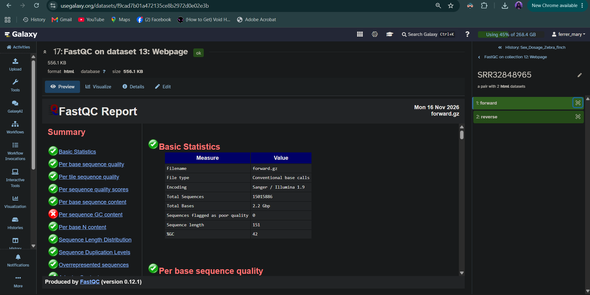
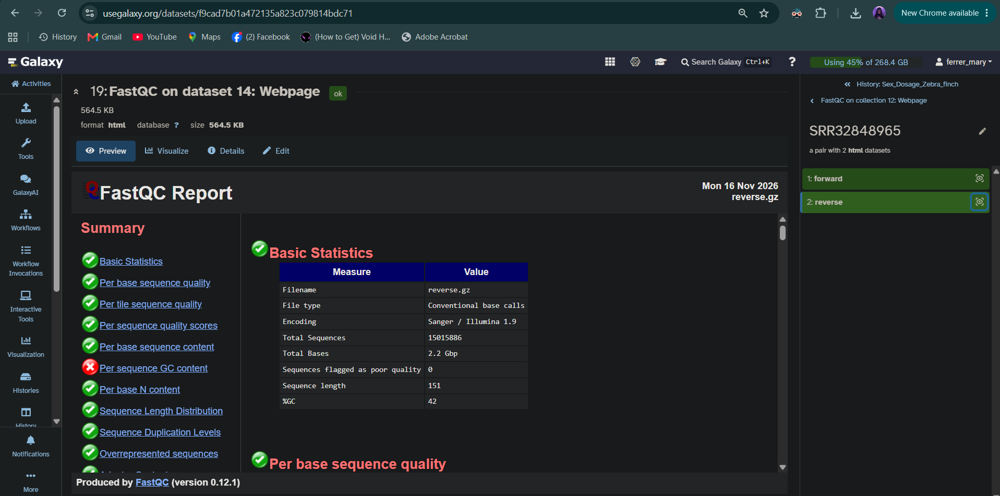
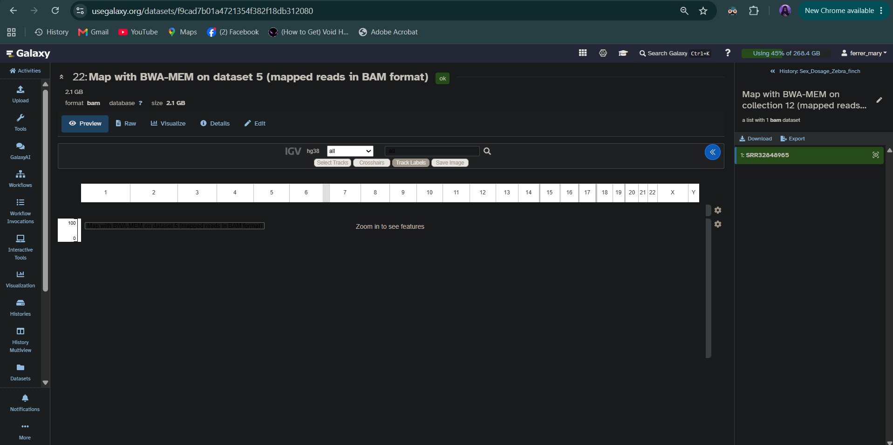
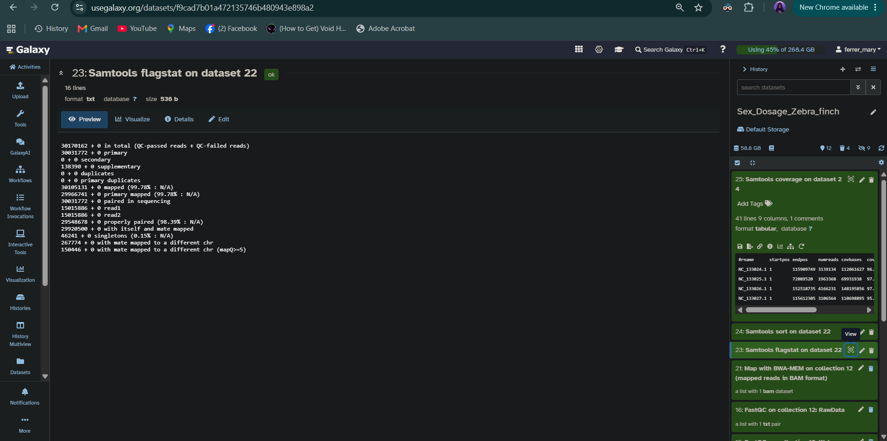
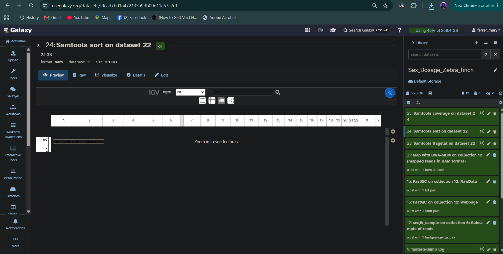
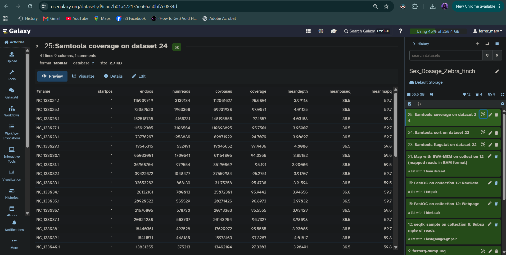
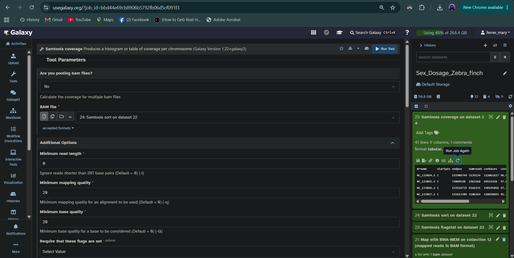
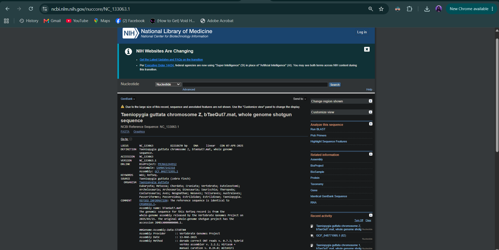
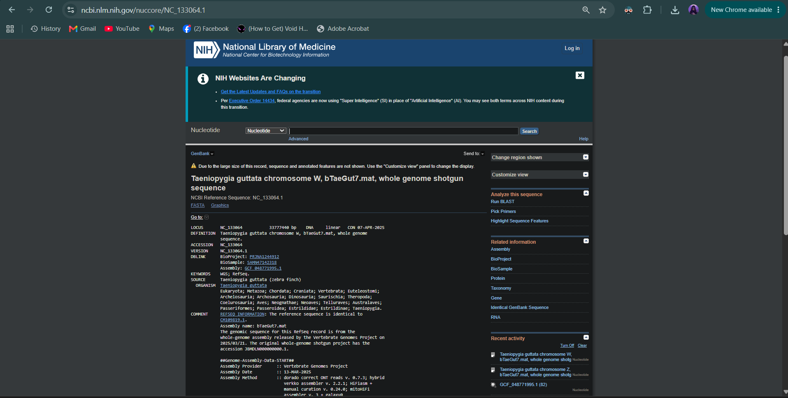
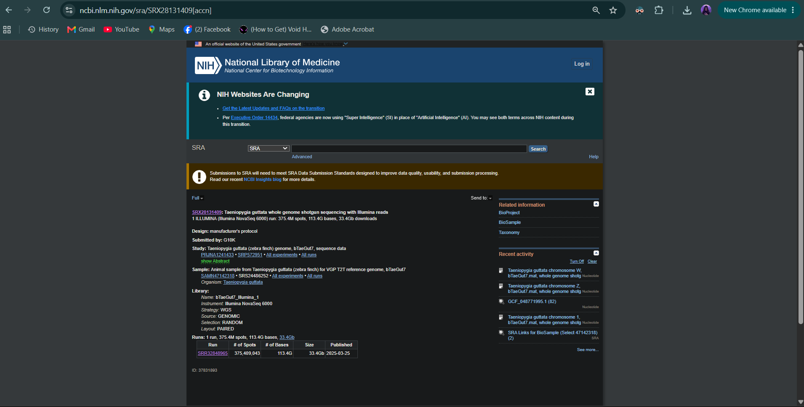

## Chromosome groups

`chromosome_groups.csv` has 41 rows. NC_133024.1 to NC_133062.1 (39 sequences) are labeled A, NC_133063.1 is labeled Z and NC_133064.1 is labeled W. The names match the `rname` column of the coverage file exactly. The reference has no mitochondrial, unplaced or alternate sequences in its 41 sequences, so none had to be left out.

## Results

| Measure | Value |
|---|---|
| Median autosome depth | 3.852 |
| Z mean depth (NC_133063.1) | 2.041 |
| Z:A ratio | 0.53 |
| W mean depth (NC_133064.1) | 1.562 |
| W:A ratio | 0.406 |
| Dosage interpretation | ZW-like |

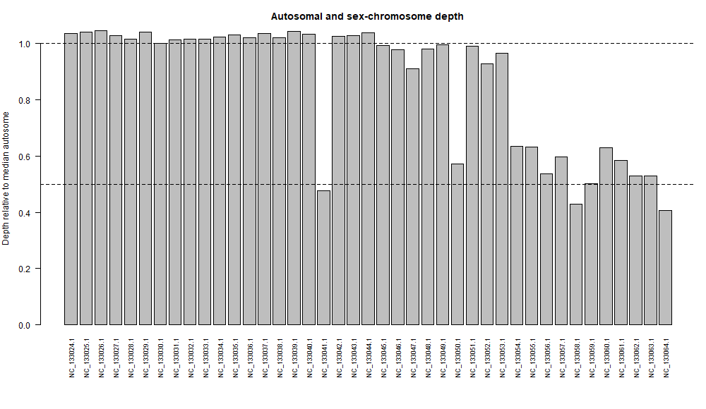

Most of the large autosomes have a relative depth near 1.0 (about 0.91 to 1.05). Z and W are clearly lower. Several small chromosomes are also low (see Limitations).

## Answers to the six questions

**1. What species did you choose, and what evidence supports a diploid ZZ/ZW system?**
I chose the zebra finch, Taeniopygia guttata. Birds have a ZZ/ZW system where males are ZZ and females are ZW. In the NCBI RefSeq assembly bTaeGut7.mat, NC_133063.1 is titled chromosome Z and NC_133064.1 is titled chromosome W, and the record gives /chromosome="Z" and /chromosome="W". <<FILL one authoritative reference that the zebra finch is diploid with a ZZ/ZW system>>

**2. What are your assembly accession, WGS run, and both BioSample accessions? Are the donors the same?**
The assembly is GCF_048771995.1 (GenBank GCA_048771995.1), named bTaeGut7.mat. The WGS run is SRR32848965. The assembly BioSample is SAMN47142318 and the WGS BioSample is also SAMN47142318, so the donor is the same individual.

**3. Which sequences were used as autosomes and as Z, and how did you verify their identities?**
I used NC_133024.1 to NC_133062.1 (39 sequences) as autosomes, NC_133063.1 as Z and NC_133064.1 as W. I checked the NCBI records for NC_133063.1, NC_133064.1 and NC_133024.1, which are titled chromosome Z, chromosome W and chromosome 1. In the NCBI list for the assembly I also saw NC_133025.1 (chromosome 1A), NC_133026.1 (chromosome 2) and NC_133027.1 (chromosome 3), and the lengths matched my coverage table. The reference has 41 sequences, so with Z and W identified, the remaining 39 are the other numbered chromosomes. I did not open each of the 39 autosome records one by one.

**4. What are the median autosomal depth, Z:A ratio, and inferred complement?**
The median autosome depth is 3.852, the Z:A ratio is 0.53 and the inferred complement is ZW-like (one Z copy).

**5. Does your result agree with the recorded sex of the WGS donor?**
Yes. The BioSample SAMN47142318 lists the donor as an adult female, and a female bird is ZW. Because the reads and the assembly share the same BioSample, comparing with the recorded sex is valid. The agreement is validation and does not replace the sequence evidence. The uncertainty comes from the low depth after subsampling and the noisy small chromosomes, described below.

**6. Why is a chromosome-level assembly alone insufficient for a reliable read-depth sex inference?**
An assembly is one sequence of each chromosome and does not say how many copies the individual carries. The NCBI record describes this assembly as a maternal haplotype, so it holds a single Z and a single W whatever the sex of the bird. Chromosome lengths also do not give copy number. Only mapping the reads and comparing depth on Z to depth on the autosomes shows the dosage.

## Limitations

I subsampled the reads to 4%, so the mean depth is only about 4x, which makes each ratio less precise. Many small chromosomes have low relative depth, for example NC_133041.1 (0.476), NC_133050.1 (0.573) and NC_133054.1 to NC_133062.1 (about 0.43 to 0.64). These have lower mean mapping quality (about 46 to 53), which suggests repeats and mapping bias, and several of them have ratios close to the Z value. Because they are included as autosomes, they may lower the median slightly. Z is a large chromosome (about 82 Mb) with higher mapping quality (57.6), so its low ratio is more reliable than the small chromosomes' values, but I did not test a macro-autosome-only median. W is repeat-rich and similar in sequence to Z, so W reads can map to Z and raise its depth a little, and the W:A ratio is only supporting evidence. The 0.80 and 0.65 cutoffs in the script are teaching guidelines and not diagnostic thresholds. FastQC failed per-sequence GC content for both files, and I did not mark duplicates. This result is for one individual only.

## Repository contents

`README.md` is this report. `sex_depth_analysis.R` is the instructor's R script, used unchanged. `chromosome_coverage.tsv` is the Samtools coverage table from Galaxy. `chromosome_groups.csv` is the chromosome label file. The `Results` folder has `chromosome_relative_depth.csv`, `chromosome_depth.png` and `sex_inference.txt`. The `Screenshots` folder has the Galaxy and NCBI screenshots. No FASTQ, FASTA, BAM or CRAM files are included.

## References

NCBI Datasets, genome assembly GCF_048771995.1: https://www.ncbi.nlm.nih.gov/datasets/genome/

NCBI SRA, run SRR32848965: https://www.ncbi.nlm.nih.gov/sra

Galaxy: https://usegalaxy.org

Samtools coverage documentation: https://www.htslib.org/doc/samtools-coverage.html

Sex-chromosome coverage review: https://pmc.ncbi.nlm.nih.gov/articles/PMC6900093/

Li H. (2013) Aligning sequence reads, clone sequences and assembly contigs with BWA-MEM. arXiv:1303.3997.
